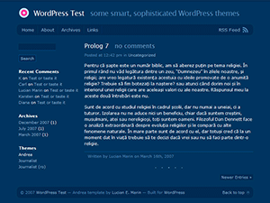

# Andrea 0.3

Minimalist, fixed-width two-column WordPress theme (`#00355f` deep blue palette) designed by Lucian E. Marin (`http://lucianmarin.com/`).

- **Version**: 0.3 (June 3, 2008)
- **Compatibility**: Built for WordPress 2.5+
- **Layout**: Fixed-width, two-column layout with custom templates for archives (`archives.php`), posts (`posts.php`), links (`links.php`), pages (`page.php`), single entries (`single.php`), comments (`comments.php`), and search (`search.php`).

## Installation

1. Copy or upload the `wp-andrea` (or `andrea`) folder into your WordPress `wp-content/themes/` directory.
2. Log in to the WordPress administration panel and navigate to **Presentation** (or **Appearance → Themes**).
3. Select and activate **Andrea 0.3**.

## Browser Support

Tested in:
- Firefox 1 / 2 / 3
- Opera 8 / 9
- Safari 2 / 3
- Internet Explorer 6 / 7